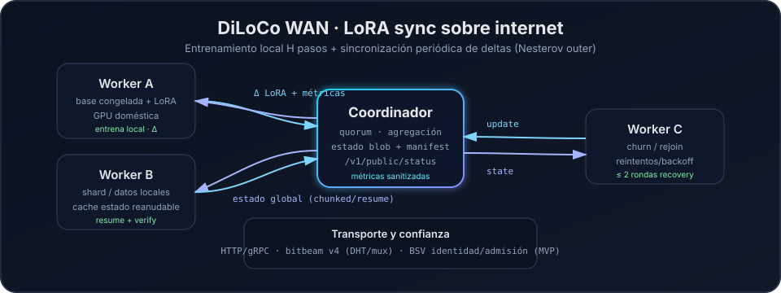

# ◆ DiLoCo WAN

> 🌍 [English](docs/en/README.md) · [Español](README.md) · [Français](docs/fr/README.md) · [中文](docs/zh/README.md) · [日本語](docs/ja/README.md)

> **Entrena adaptadores LoRA de 32B/70B sobre internet, sin datacenter.**

[](#)
[](#)
[](#)
[](#)

DiLoCo WAN adapta modelos grandes usando **DiLoCo** (*Distributed Low-Communication*):
sincroniza solo el adaptador LoRA cada `H` pasos locales con optimizador exterior
Nesterov. La base queda congelada (NF4/QLoRA), cada isla cabe en una GPU doméstica
y el tráfico por ronda baja drásticamente frente a replicar pesos completos.

**Estado público (sanitizado):** https://didiloco.bsv.direct/ · API: https://didiloco.bsv.direct/api/status



---

## ✨ Características

| | |
|---|---|
| 🧠 **Backend** | `toy` (CPU determinista) + `hf` (PEFT/QLoRA), carga thread-safe |
| 🌐 **Coordinador** | HTTP/gRPC, token, quorum, deadline, heartbeat, late join, `/v1/state_meta`, `/v1/public/status` (sanitizado) |
| 📦 **Estado WAN** | descarga reanudable/verificada (Range/chunks/manifest/hash/Merkle/ETag), cache de blob en memoria y persistente por contenido |
| 🗜️ **Compresión** | int8 (4×), top-k + error feedback; base para negociación `zstd` en progreso |
| 🔄 **Robustez/churn** | reintentos/backoff, re-registro ante sesión perdida, rejoin/evicción, recuperación ≤ 2 rondas (tests) |
| 🔐 **Seguridad** | TLS/mTLS opcional, validación base/config/hash; identidad BSV por nodo + allowlist/admisión por pubkey (MVP), firmas/invites; dashboard/agente con auth |
| 💾 **Storage** | checkpoints atómicos, retención, object store local/S3 |
| 🌍 **P2P/WAN** | túnel **bitbeam v4** (DHT) multiplexado persistente, canal por par ECDH con identidad BSV, late-join/revocación por archivo de peers (en progreso) |
| 🖥️ **Web** | estado público (`web/public/`), consola operativa (`web/dashboard.*`) y monitor de red (`web/network.*`) |
| ⌨️ **CLI/UX** | wrappers `./coordinator` `./worker` `./agent` `./pilot`, wizards, autodetección de init-state, invite firmado |

## 🏗️ Arquitectura

- **Workers/islas:** entrenan localmente `H` pasos sobre la base congelada y producen deltas del adaptador LoRA.
- **Coordinador:** valida, agrega (quórum) y aplica el optimizador exterior Nesterov; publica estado global verificable.
- **Distribución de estado:** blob cacheado con metadatos/manifest; clientes descargan por chunks, reanudan, verifican y reutilizan cache local.
- **Transporte:** HTTP directo, gRPC opcional, o túnel bitbeam v4 (DHT/mux). Identidad/admisión BSV en evolución (MVP).
- **Plano público vs privado:** `/api/status` expone solo métricas agregadas/sanitizadas; dashboard/agente/coordinador de control deben permanecer privados y autenticados.

## 🚀 Inicio rápido

```bash
# Tests
.venv/bin/python -m unittest discover -s tests -q

# Smoke local (toy, CPU)
.venv/bin/python scripts/smoke_local.py --reset --rounds 4 --workers 2 --device cpu

# Wrappers
./coordinator --config configs/smoke.json --device cpu --reset --max-rounds 4 --no-wait
./worker --config configs/smoke.json --node-id node-0 --coordinator http://127.0.0.1:8095 --device cpu

# Dashboard/agente local (sirve web/ y abre navegador)
./agent --open
```

**HF (ejemplo):** usa configs locales con rutas/modelos reales. Para HF el coordinador puede autodetectar/exportar init-state (`--init-state auto`) si hace falta.
```bash
./coordinator --config configs/<local-hf>.json --checkpoint-dir runs/<run> --max-rounds 3 --no-wait --p2p-topic diloco-run
./worker --config configs/<local-hf>.json --node-id node-0 --shard-id 0 --p2p-topic diloco-run --tunnel-listen-port 18080 --device cuda
```
Si el worker tiene init-state/cache compatible, evita re-descargar el estado global completo.

**Flujo one-command (recomendado, sin editar archivos):**
```bash
# Quien organiza: imprime una línea didiloco://join?... y su QR
.venv/bin/python scripts/pilot.py up --name demo --preset toy --workers 2

# Cada worker (en otra máquina): pega la línea
.venv/bin/python scripts/pilot.py join 'didiloco://join?...' --node-id worker-a
```
Ver [docs/ONE_COMMAND.md](docs/ONE_COMMAND.md).

**Entrenar en GPU con Docker:** [docs/DOCKER_GPU.md](docs/DOCKER_GPU.md) — imagen CUDA + HF/PEFT, `docker compose -f deploy/docker-compose.gpu.yml` y `JOIN_CODE`.

**Identidad BSV + invite firmado (MVP):**
```bash
.venv/bin/python scripts/identity_init.py --name coordinator
.venv/bin/python scripts/identity_init.py --name node-0
./coordinator --config <local>.json --coordinator-identity runs/identity/coordinator.json \
  --allow-pubkey-file runs/identity/node-0.json --require-node-identity \
  --p2p-topic diloco-run --print-invite runs/invite.json --max-rounds 3 --no-wait
./worker --config <local>.json --node-id node-0 --shard-id 0 --device cuda \
  --node-identity runs/identity/node-0.json --invite runs/invite.json
```

## 🌐 Despliegue público/privado

- **Público:** `web/public/` + endpoint sanitizado `/v1/public/status` (proxyeado como `/api/status`) — sin IDs de nodos, claves, endpoints de control ni logs.
- **Privado (control):** `web/dashboard.*` + `scripts/agent.py` (launcher/procesos) y coordinador — deben correr autenticados y detrás de proxy seguro/VPN/allowlist.
- **Guía detallada:** [docs/DEPLOY_PUBLIC_DASHBOARD.md](docs/DEPLOY_PUBLIC_DASHBOARD.md)
- **Deploy VPS (docker + nginx-certbot/proxy-net):** `./deploy/deploy_vps.sh` (no sobrescribe `deploy/.env` remoto). Revisa `deploy/README.md` y `deploy/nginx/`.

## 🌍 P2P (bitbeam v4)
```bash
cd network/holepunch-sidecar && npm install
```
- **Topic compartido (fallback):** `--p2p-topic` crea un túnel persistente multiplexado.
- **Por par (identidad):** con identidades/pubkeys o invite, el túnel puede usar contexto ECDH por par.
- Requiere Node.js y conectividad DHT. Para bootstrap grande/inestable, usa `--init-state` local y/o transporte directo.

## 📚 Documentación
- [Onboarding](docs/ONBOARDING.md) — de cero a tu primera ronda.
- [One-command](docs/ONE_COMMAND.md) · [Docker GPU](docs/DOCKER_GPU.md) · [Validación WAN/NAT](docs/VALIDACION_WAN_NAT.md)
- [Despliegue público/privado](docs/DEPLOY_PUBLIC_DASHBOARD.md) — estado público, dashboard/agente privado y nginx.
- [Algoritmo](docs/01-algoritmo.md) · [Arquitectura](docs/02-arquitectura.md) · [Comunicación](docs/03-comunicacion.md)
- [Modelos](docs/04-modelos.md) · [Entrenamiento](docs/05-entrenamiento.md) · [Operaciones](docs/06-operaciones.md)
- [Seguridad](docs/07-seguridad.md) · [Experimentos](docs/08-experimentos.md) · [Referencias](docs/09-referencias.md)
- [Plan de vanguardia](docs/PLAN_VANGUARDIA.md) · [Changelog](CHANGELOG.md) · [Estado](STATUS.md) · [Roadmap](ROADMAP.md)

## 📄 Licencia
MIT (`LICENSE`).